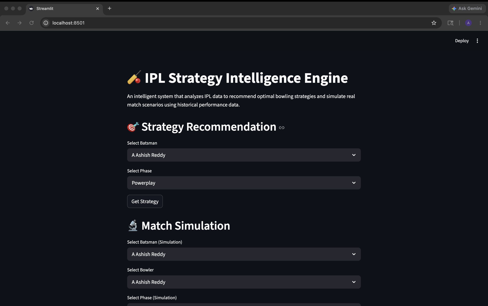
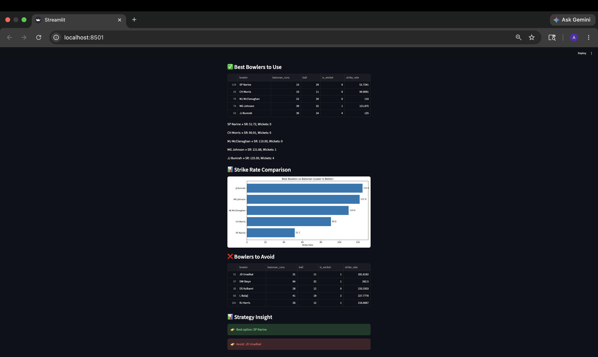

# IPL Strategy Intelligence Engine — Prototype V1

A Streamlit prototype that uses historical IPL delivery data to explore batter–bowler matchups by match phase.

## What it does

- Lets a user select a batter and innings phase (Powerplay, Middle, or Death)
- Ranks bowlers by the batter's historical strike rate, with a minimum sample of 11 deliveries
- Shows a bar chart for the lower-strike-rate bowlers
- Calculates historical strike rate and wicket frequency for a selected batter–bowler–phase combination

The “match simulation” is a summary of the available historical matchup data; it is not a probabilistic simulation or a predictive model.

## Screenshots






## Technologies

Python, pandas, Streamlit, and Matplotlib.

## Run locally

```bash
python3 -m pip install streamlit pandas matplotlib
python3 -m streamlit run app.py
```

The app expects `data/deliveries (2).csv` to remain in place.

## Repository layout

```text
app.py                  Streamlit application
data/                   IPL delivery-level data
screenshots/            Application screenshots
```

## Scope and limitations

This is an exploratory learning prototype. Recommendations are descriptive summaries of the included historical data and should not be interpreted as real-time tactical advice.
